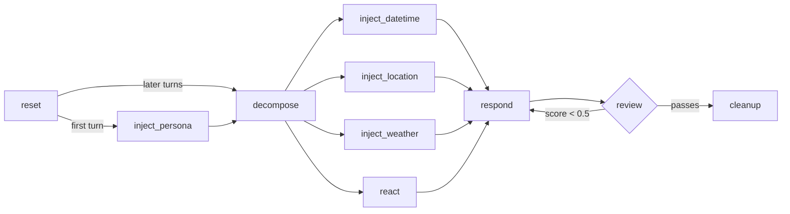

# Riliane

A persona chatbot built as a [LangGraph](https://github.com/langchain-ai/langgraph) state graph on local models served by [Ollama](https://ollama.com), plus the pipeline I used to fine-tune a model in the persona's voice. It's a personal experiment in agent design and small-model fine-tuning.

## How the chatbot works

Each user message runs through this graph:



- **inject_persona** builds the system prompt from a persona and a rule set, on the first turn only.
- **decompose** has the model summarize what the user actually wrote.
- **Context nodes** run in parallel: date and time, location and weather (location and weather are placeholders).
- **react** scores the persona's sentiment toward the message and turns it into short guidance for the reply.
- **respond** drafts the reply in character.
- **review** is an LLM-as-judge step with structured output. Two evaluators score the reply from 0.0 to 1.0: one for staying in character, one for matching the persona's voice. If either scores below 0.5, the reply goes back to `respond` with the reviewer's comments.
- **cleanup** strips stage directions such as `*giggles*` and saves the turn.

Conversation history is kept per thread with LangGraph's `MemorySaver`.

## Fine-tuning

The `train/` folder holds the pipeline for teaching a base model the persona's voice:

1. **Generate data.** `split.py` turns the [Alpaca-cleaned](https://huggingface.co/datasets/yahma/alpaca-cleaned) instructions into OpenAI Batch API requests, with the persona as the system prompt (`gpt-4.1-mini`). `merge.py` joins the batch responses back to their instructions, producing about 52,000 persona-voiced examples.
2. **Fine-tune.** `finetune.ipynb` trains a LoRA adapter (rank 16) on Llama 3.1 8B with [Unsloth](https://github.com/unslothai/unsloth) in 4-bit, then merges and exports it to GGUF (Q8_0) for llama.cpp or Ollama.

The training scripts also need `openai`, `python-dotenv`, `tqdm`, `unsloth`, `trl` and `datasets`. Run them from the repo root, for example `PYTHONPATH=. python train/split.py`.

## Running the chatbot

Requirements: Python 3.12+ and Ollama running locally with the model pulled (`ollama pull dolphin3:8b`; the model is set in `chatbot.py`).

```bash
pip install -r requirements.txt
python run.py
```

`run.py` loads `assets/riliane7.md` and `assets/rules.json` by default. `--persona` also accepts a `.json` profile, which the model expands into a full persona. Type `quit` to stop.

Models, generated data and API keys are not committed. Put `OPENAI_API_KEY` in `.env` if you want to regenerate the dataset.

## Status

Exploration project, not production code. A larger refactor (an async two-model reaction subsystem, mood tracking, reasoning routing and memory hooks) lives on the `refactor-async-react` branch and doesn't run end to end yet.
